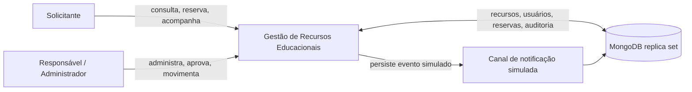
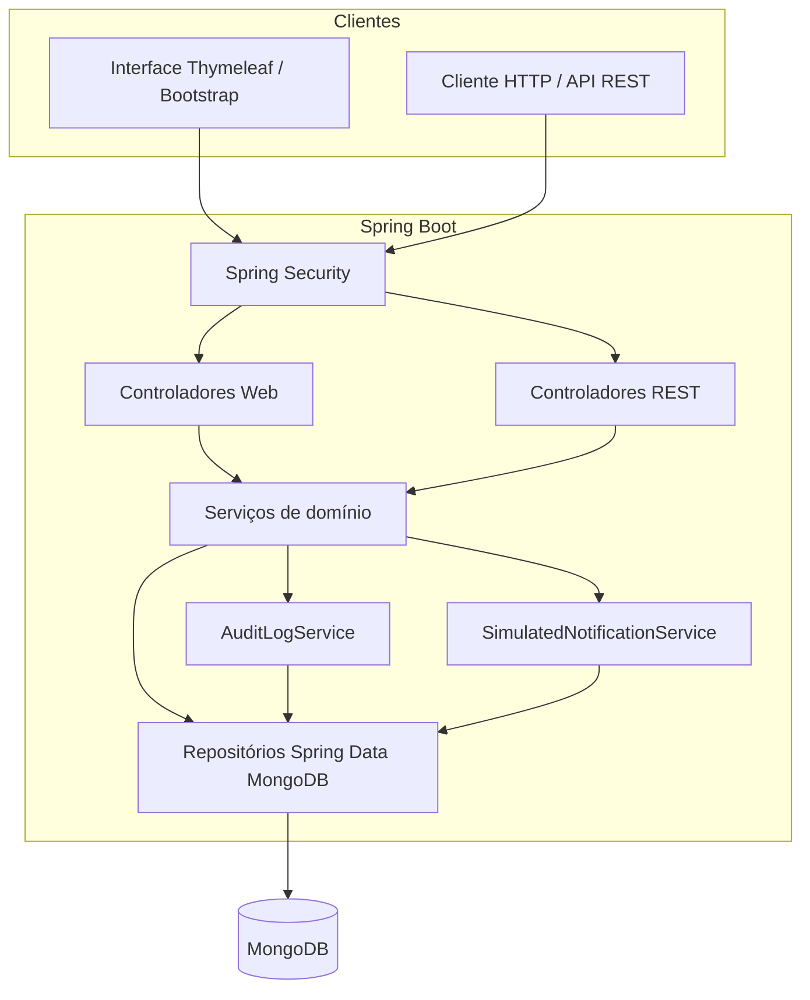
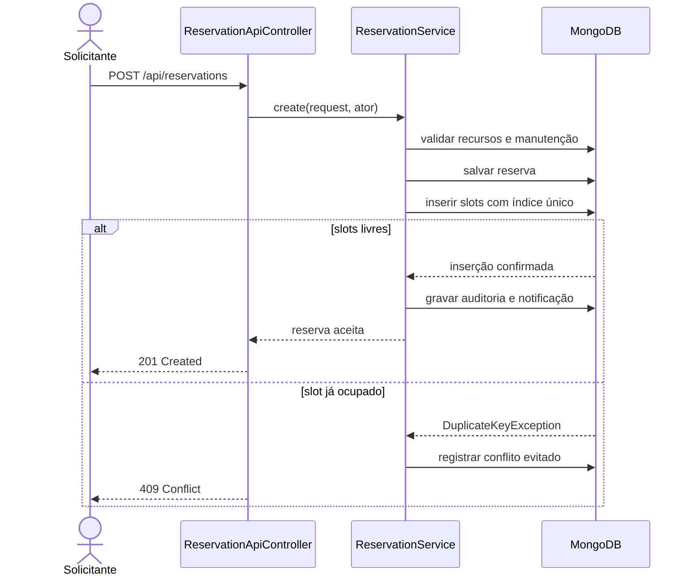
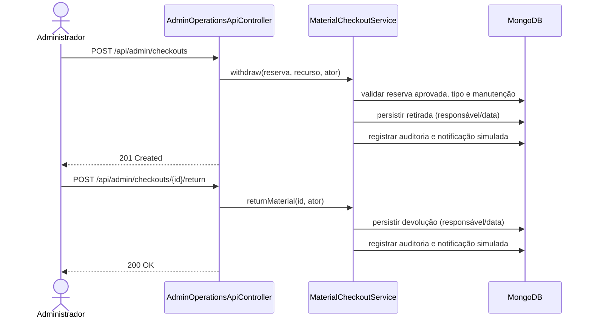
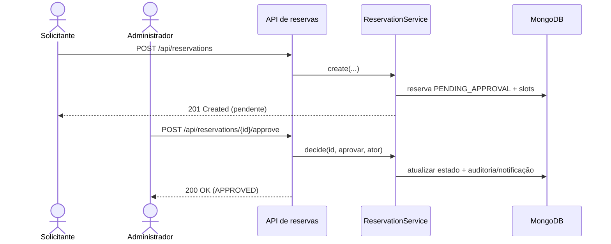

# Diagramas de arquitetura e sequências

Diagramas Mermaid. Renderizar em visualizador compatível com Mermaid (por exemplo, GitHub) ao apresentar o projeto.

## Contexto

## Componentes

## Reserva e bloqueio concorrente

## Retirada e devolução

## Decisão de recurso restrito

